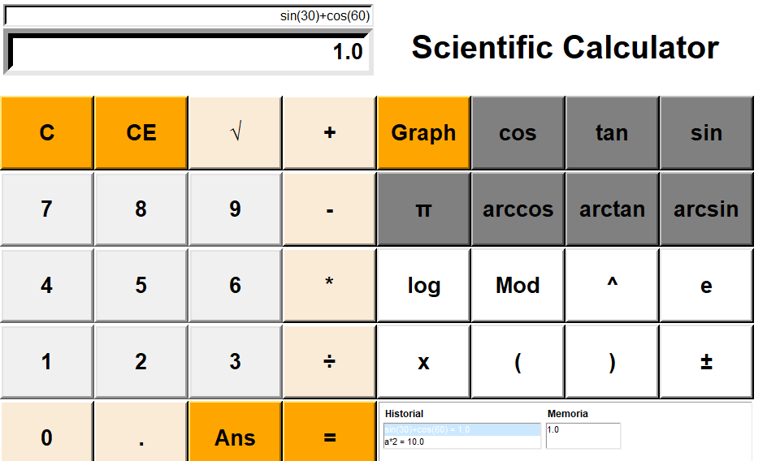
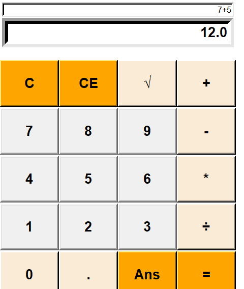
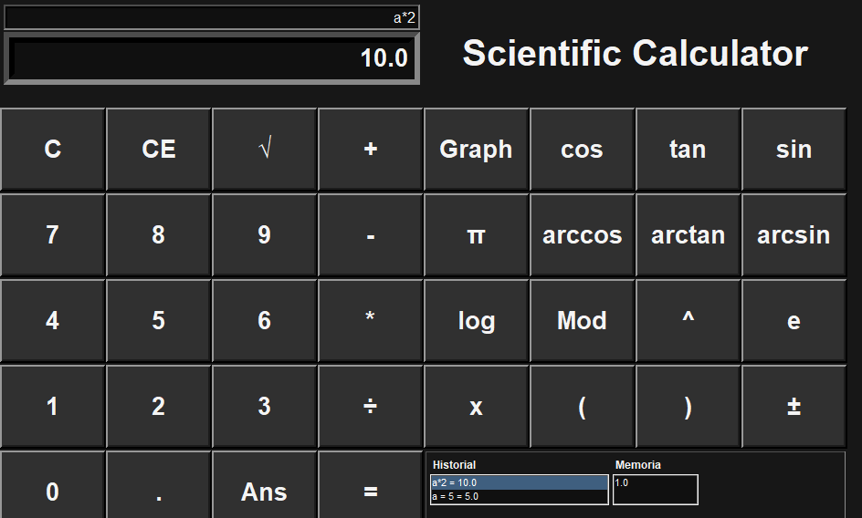
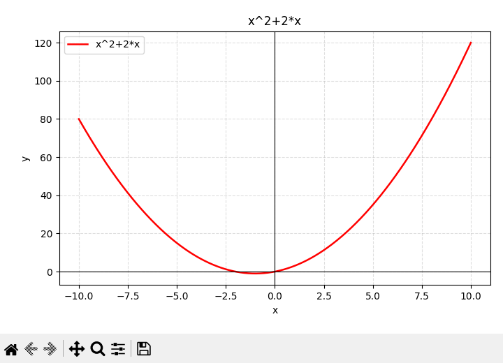
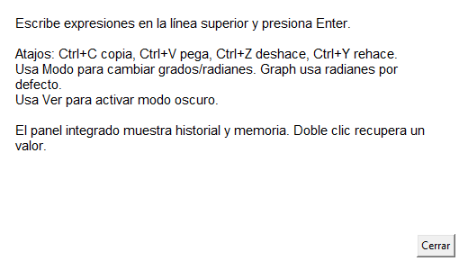

# Scientific And Graphing Calculator

A Tkinter scientific calculator with safe typed expressions, Matplotlib graphing, history, memory, dark mode, typed core contracts, and GUI smoke coverage.



## Features

- Basic arithmetic, modulo, powers, square root, square, cube, reciprocal, percent, factorial, and absolute value
- Scientific functions: trig, inverse trig, hyperbolic trig, logarithms, log-base, constants, and scientific notation
- Typed expressions such as `2 + 3 * sqrt(16)`, `sin(30) + cos(60)`, `logb(8,2)`, and `1.2e3`
- Calculator variables with assignment, for example `a=5` followed by `a*2`
- Matplotlib graph window with discontinuity-aware sampling and variable support
- Two-line editable expression/result display, inline errors, copy/paste, undo/redo, tooltips, and help
- Built-in history and memory panels with recall actions
- Light and dark themes

## Important Semantics

- Calculator expressions default to degrees.
- Graph expressions default to radians and can be switched independently from the `Modo` menu.
- `%` is modulo in typed expressions; use the percent button or `percent(x)` for percentage conversion.
- Calculator variables cannot shadow built-ins such as `sin`, `sqrt`, `pi`, `e`, or graph variable `x`.

## Project Structure

- `app.py` - Tkinter GUI entrypoint
- `calculator.py` - calculator state, history, undo/redo, memory-facing math behavior
- `graphing.py` - safe expression parser/evaluator and graph point sampling
- `graph_renderer.py` - Matplotlib figure rendering
- `tests/` - unit and GUI smoke tests
- `assets/` - app icon assets
- `docs/` - packaging notes and screenshots

## Feature Screenshots

### Standard Calculator

Only the four-column standard calculator is visible in standard mode.



### Scientific Calculator

Scientific mode adds graphing, trig, inverse trig, constants, powers, logs, parentheses, history, and memory.


### History And Memory

The integrated panel keeps recent expressions/results and saved memory values close to the keypad.


### Dark Mode

Dark mode applies to the calculator, display, buttons, and integrated panels.



### Graph Window

Graphing uses Matplotlib in a separate window with axes, grid, navigation toolbar, discontinuity-aware sampling, and variable support.



### Help

The Help menu documents entry, shortcuts, angle modes, theme controls, and panel recall.



## Install And Run

```bash
python -m pip install --upgrade pip
python -m pip install -r requirements.txt
python app.py
```

The project also defines an installable script entrypoint:

```bash
python -m pip install -e .
scientific-calculator
```

## Test

Run the headless unit suite:

```bash
python -B -m unittest discover -s tests -v
```

Run the syntax probe used by CI:

```bash
python -B -c "from pathlib import Path; files=['app.py','calculator.py','graphing.py','graph_renderer.py','tests/test_calculator.py','tests/test_graphing.py','tests/test_graph_renderer.py','tests/test_project_metadata.py','tests/smoke_gui.py']; [compile(Path(f).read_text(encoding='utf-8'), f, 'exec') for f in files]; print('syntax ok')"
```

Run the GUI smoke test on a display-capable machine:

```bash
python -B tests/smoke_gui.py
```

The GUI smoke test writes `test-artifacts/calculator_smoke.png`.

## Final Verification

Latest local verification completed successfully:

- stale-reference scan: clean
- syntax probe: OK
- unit tests: `57` passing tests
- GUI smoke: OK, including standard/scientific visibility, graphing, dark mode, history, memory, clipboard, undo/redo, and screenshots
- icon generation: OK
- PyInstaller build: OK, produced `dist/ScientificCalculator.exe`
- packaged executable launch check: OK, app started and responded

## Code Quality

- Core modules include type hints for public contracts, snapshots, graph sampling, rendering, and GUI helpers.
- Engine and graph modules include docstrings for state snapshots, history records, safe expression evaluation, and renderer behavior.
- Tests cover the typed-expression parser, calculator engine, graph sampling, Matplotlib renderer, project metadata, and GUI smoke workflows.

## Package

Packaging instructions live in [docs/PACKAGING.md](docs/PACKAGING.md). The short Windows build command is:

```powershell
python -m pip install -r requirements-dev.txt
python tools/create_icon.py
python -m PyInstaller --noconfirm --onefile --windowed --name ScientificCalculator --icon assets/app_icon.ico app.py
```

Validate the packaged app manually before release: launch it, run typed expressions, use scientific buttons, open graphing, check history/memory, and toggle dark mode.

See [CHANGELOG.md](CHANGELOG.md) and [docs/RELEASE_NOTES.md](docs/RELEASE_NOTES.md) for release context.
